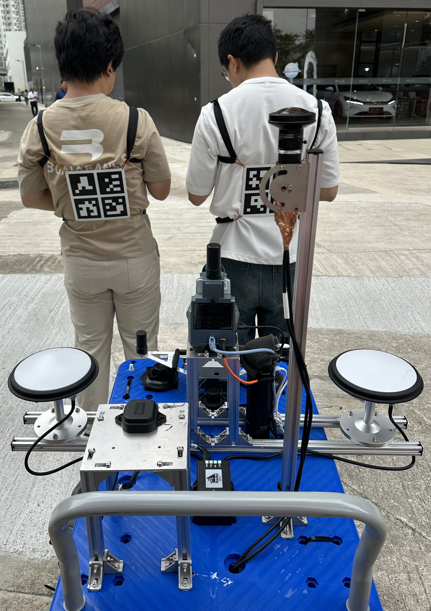
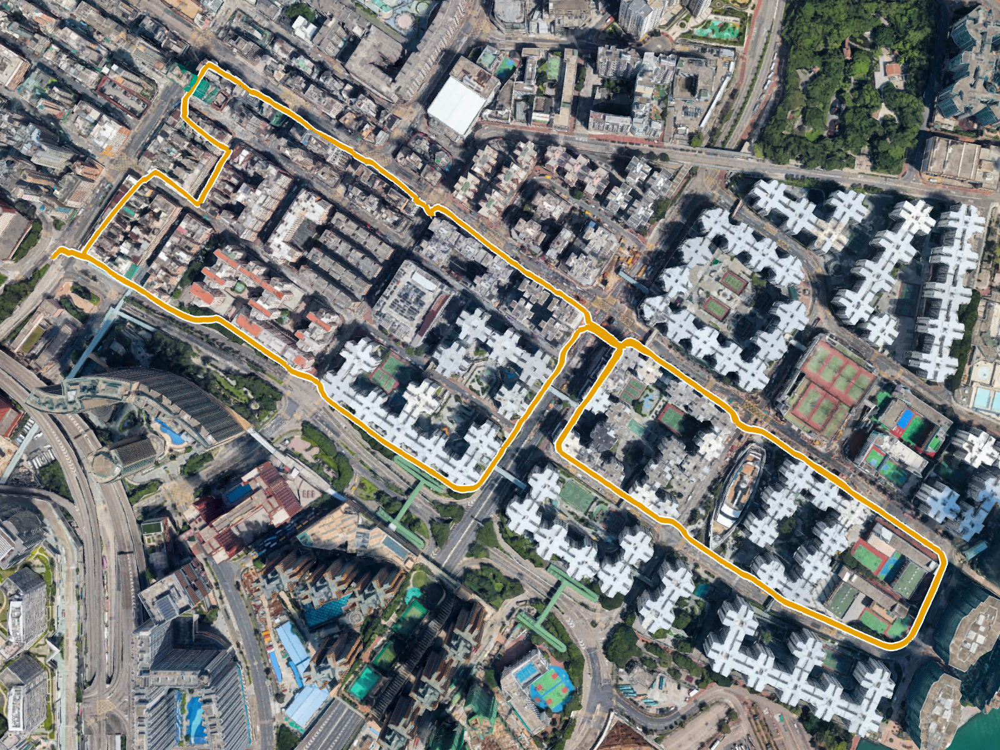
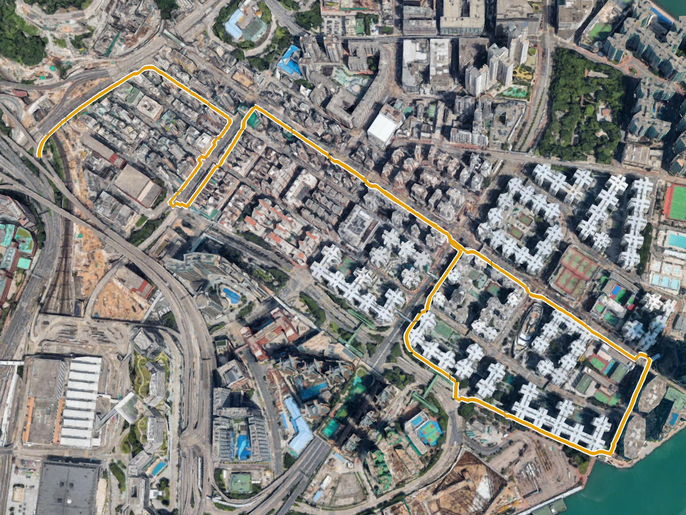
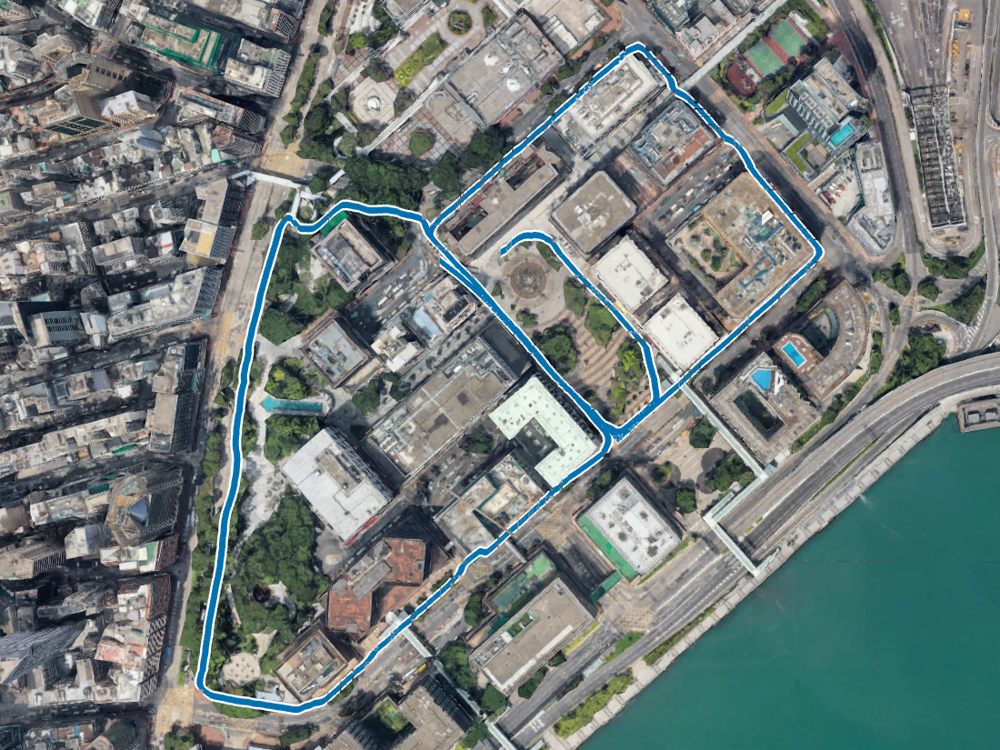
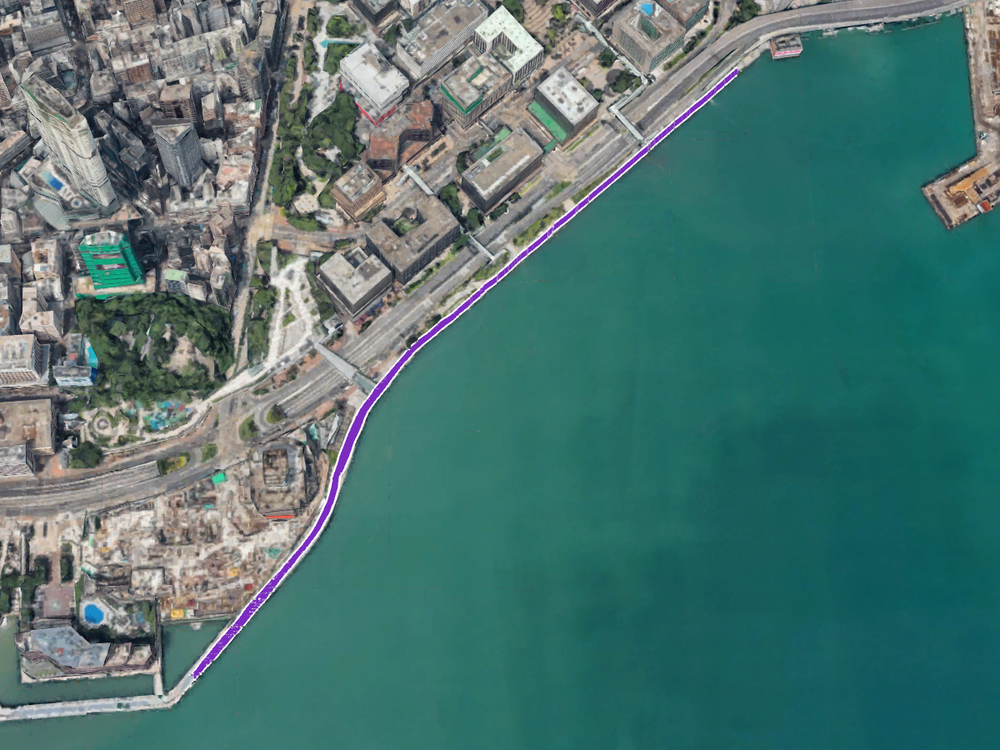
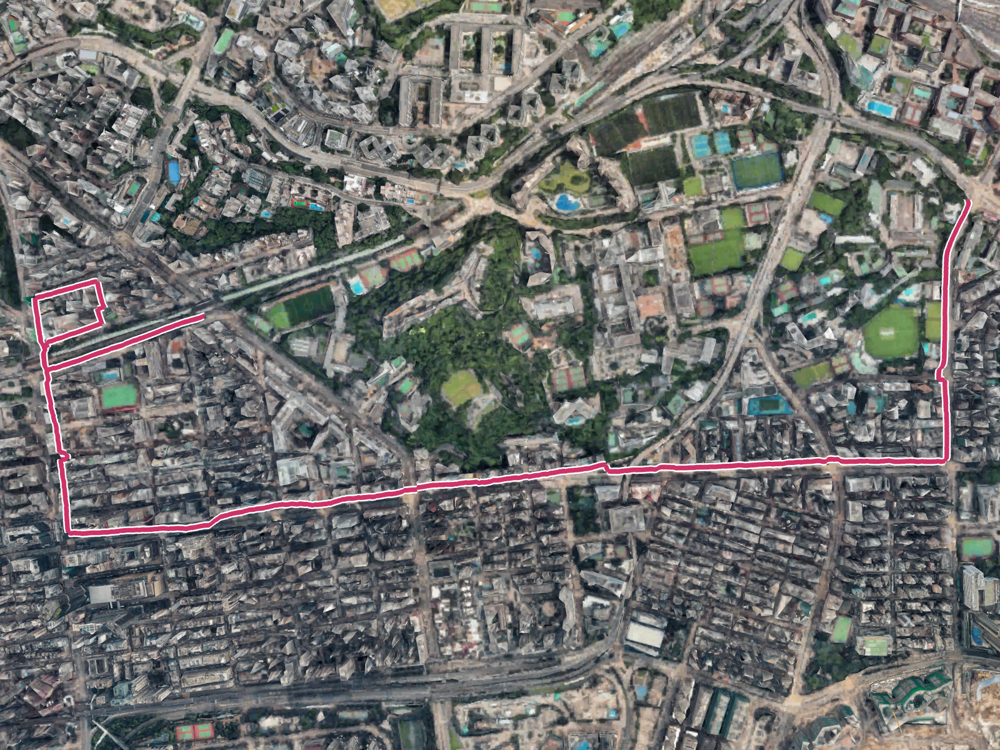
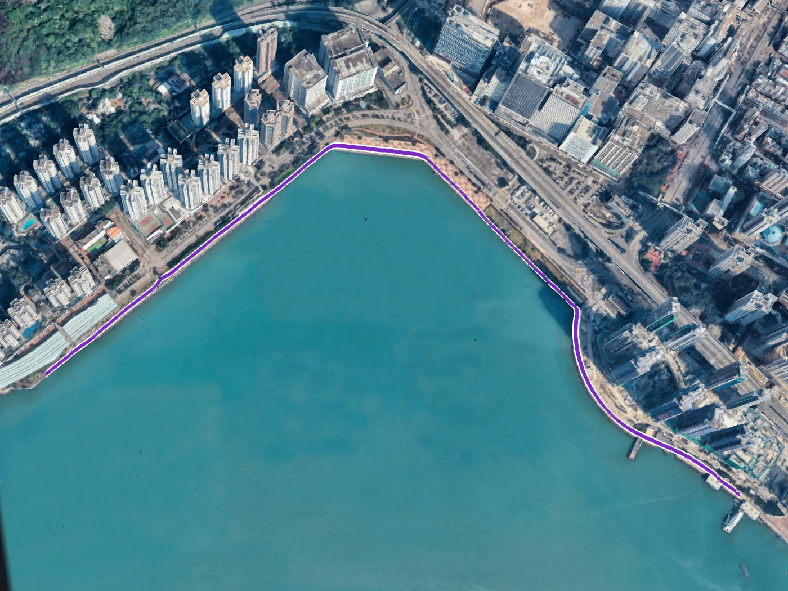
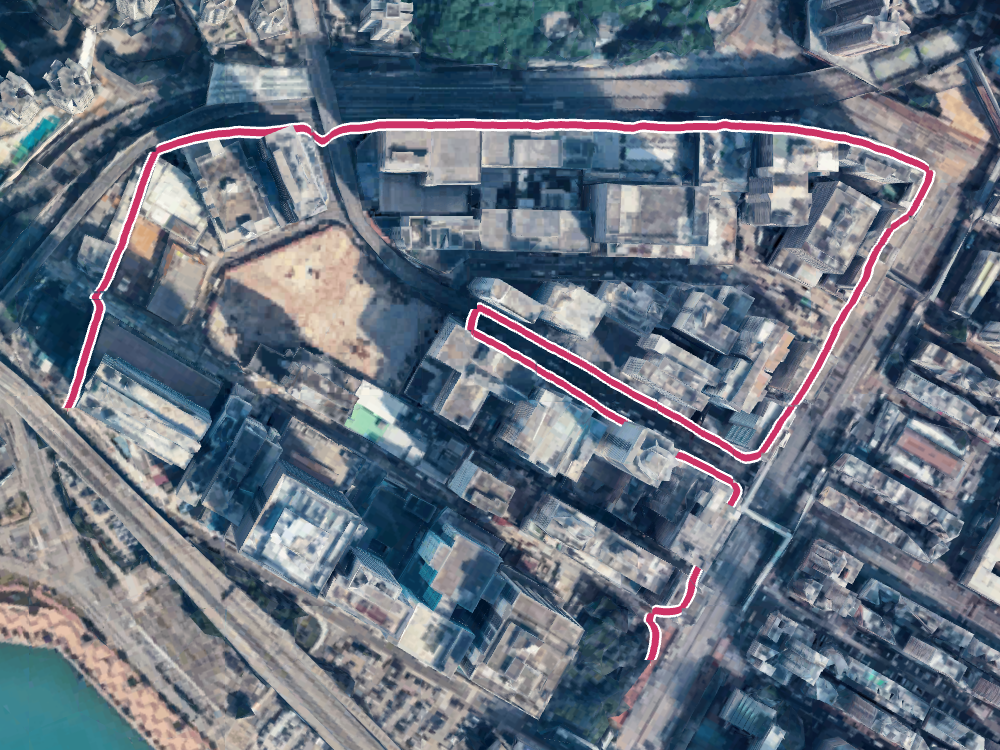

# PedROAM

**A Smartphone Multisensory Dataset for Benchmarking Urban Pedestrian Positioning Algorithms**

PedROAM (***Ped***estrian ***R***aw-GNSS ***O***bservations and ***A***ndroid ***M***ultisensor ***M***easurements) provides raw GNSS and Android sensor measurements from natural handheld pedestrian walks in Hong Kong, with independent per-participant reference trajectories. Seven sessions collected on **21–23 April 2026** cover **light, middle, deep and harsh** urban environments, with **13 Google Pixel 10 Pro streams**.



The dataset provides **8.90 h** across **13 recordings**, with individual durations of **24.0–64.1 min** and assessment routes totaling **16.67 km**. The uploaded directory inventory contains **9.85 GB of stored files**, including compressed per-session 3D model ZIPs.

## Overview

- [Sensor setup](#sensor-setup)
- [Hong Kong sessions](#hong-kong-sessions)
- [Session details and routes](#session-details-and-routes)
- [Browse and download](#browse-and-download)
- [GT precision reference: IE standard deviations](#gt-precision-reference-ie-standard-deviations)
- [Getting started](#getting-started)
- [Citation and terms](#citation-and-terms)

## Sensor setup

Participants walked naturally with phones held approximately horizontally at chest level, broadly aligned with walking direction. The independent reference cart followed participants wearing identity-coded ArUco boards on their backs.

| Measurement | Device / system | Available data |
|---|---|---|
| Phone GNSS, nominal 1 Hz | Google Pixel 10 Pro, Android 16; GNSSLogger | Converted RINEX 3.05, native RINEX 4.01, NMEA; Android raw logs in 12/13 streams |
| Motion, nominal 100 Hz | Phone accelerometer, gyroscope, magnetometer and orientation | Original SensorLogger CSVs, calibrated/uncalibrated streams where recorded |
| Other phone sensors | Gravity, compass, barometer, system location and pedometer | Native sensor CSVs and original recording metadata |
| Pedestrian reference | NovAtel SPAN CPT7 GNSS/INS + GeoScan 2 camera/LiDAR + back-mounted boards | Existing matched per-participant WGS-84 trajectory CSVs |
| GT precision reference | Inertial Explorer (IE) GNSS/INS solution | Per-session position and attitude standard-deviation exports in `recordings/IE-STDs/` |
| Environment | Hong Kong Lands Department | Assessment-track sky masks, per-session 3D models and shared official GeoJSON pedestrian network |

The reference point is each pedestrian's **back-mounted fiducial-board center**, with no fixed phone-to-body lever arm. Raw rig images, LiDAR recordings, mixed rosbags and algorithm intermediates are excluded.

## Hong Kong sessions

Browse recordings to inspect `phones/`, `reference/` and `navigation/`. Environment folders contain `skymask.npz` and `3d.zip`. Sizes below are **stored file totals**, including the compressed models; Dropbox-generated folder ZIP sizes may differ.

| Session | Urban setting | Phones | Recording duration / route length | Recordings | Environment |
|---|---|---|---|---|---|
| [0421-AM-2026](#session-0421-am-2026) | Deep | 2 | <strong>P01:</strong> 61.7 min<br><strong>P02:</strong> 61.8 min<br>Route: 3.50 km | [Browse](https://www.dropbox.com/scl/fo/pq05qruup73dc5di9ndp5/AFuAGSxyQ-g7sY24wFJ4OoA?rlkey=oa86b2bp059b4qy2iuofos9m0&dl=0) · [Download](https://www.dropbox.com/scl/fo/pq05qruup73dc5di9ndp5/AFuAGSxyQ-g7sY24wFJ4OoA?rlkey=oa86b2bp059b4qy2iuofos9m0&dl=1) (949.0 MB) | [Browse](https://www.dropbox.com/scl/fo/14gmo1qs4x4frmkp51rs1/AMnZBj9_IGrzGyvjpqMcPuc?rlkey=y4a2dzqh1xxw90mu162pcouz2&dl=0) · [Download](https://www.dropbox.com/scl/fo/14gmo1qs4x4frmkp51rs1/AMnZBj9_IGrzGyvjpqMcPuc?rlkey=y4a2dzqh1xxw90mu162pcouz2&dl=1) (579.4 MB) · [3D ZIP](https://www.dropbox.com/scl/fi/apotswgoqu1s35gy56xc4/3d.zip?rlkey=3pxft7wzfaeoa0vrnc3jo88cn&dl=1) · [Sky mask](https://www.dropbox.com/scl/fi/rsbaaft0adxeugyxqu4cv/skymask.npz?rlkey=xkv2sxx8cgqvtlp4w8xvginp6&dl=1) |
| [0421-PM-2026](#session-0421-pm-2026) | Deep | 2 | <strong>P02:</strong> 60.8 min<br><strong>P03:</strong> 61.0 min<br>Route: 2.94 km | [Browse](https://www.dropbox.com/scl/fo/urga3kqwezjw0091aah4z/ABzmlfzoaXqkO0lzwXwfWLw?rlkey=swxgfinful7yv9pvlmsl7rqtv&dl=0) · [Download](https://www.dropbox.com/scl/fo/urga3kqwezjw0091aah4z/ABzmlfzoaXqkO0lzwXwfWLw?rlkey=swxgfinful7yv9pvlmsl7rqtv&dl=1) (946.3 MB) | [Browse](https://www.dropbox.com/scl/fo/99vcw2t72oovmuf51d7jw/AIBW1osUPyzbwlSmgxcKfEU?rlkey=dwbes8r61k2p4ifu4eutwkhbq&dl=0) · [Download](https://www.dropbox.com/scl/fo/99vcw2t72oovmuf51d7jw/AIBW1osUPyzbwlSmgxcKfEU?rlkey=dwbes8r61k2p4ifu4eutwkhbq&dl=1) (580.0 MB) · [3D ZIP](https://www.dropbox.com/scl/fi/3hpxjdm17uoz1sdzqj4y8/3d.zip?rlkey=20ufiiojrn3frd019ub1igfxu&dl=1) · [Sky mask](https://www.dropbox.com/scl/fi/qpi87dnhrrkc22vvwsoex/skymask.npz?rlkey=a9v4b37r8p7ca623f6aumpuv5&dl=1) |
| [0422-AM1-2026](#session-0422-am1-2026) | Middle | 2 | <strong>P02:</strong> 35.6 min<br><strong>P04:</strong> 35.5 min<br>Route: 2.08 km | [Browse](https://www.dropbox.com/scl/fo/gce9qwcuxuh6d4issrqpb/AHTrzrOvhMY7Ng5gZGKVl2g?rlkey=uefpyzpalkfbawgjjyobf7p13&dl=0) · [Download](https://www.dropbox.com/scl/fo/gce9qwcuxuh6d4issrqpb/AHTrzrOvhMY7Ng5gZGKVl2g?rlkey=uefpyzpalkfbawgjjyobf7p13&dl=1) (515.8 MB) | [Browse](https://www.dropbox.com/scl/fo/pjc12u4z18k8n55qchq7a/AMFdr8KZ6fnw_zRARKJ0tRg?rlkey=6slgncw20bkyps62g7zd1fm8k&dl=0) · [Download](https://www.dropbox.com/scl/fo/pjc12u4z18k8n55qchq7a/AMFdr8KZ6fnw_zRARKJ0tRg?rlkey=6slgncw20bkyps62g7zd1fm8k&dl=1) (607.8 MB) · [3D ZIP](https://www.dropbox.com/scl/fi/97ms2zyom1juu5i6tozn1/3d.zip?rlkey=e33fyaq58b3k5atizz7wysrb0&dl=1) · [Sky mask](https://www.dropbox.com/scl/fi/80qe3fy2s51y52wtcxj4i/skymask.npz?rlkey=yasfqgrktferwfncvfcptpurh&dl=1) |
| [0422-AM2-2026](#session-0422-am2-2026) | Light | 2 | <strong>P02:</strong> 24.2 min<br><strong>P04:</strong> 24.0 min<br>Route: 1.31 km | [Browse](https://www.dropbox.com/scl/fo/h0u4y2a6mzyq1c35jv3lh/ALBgd2H_oJpVWKZhcqUPt8s?rlkey=ydwm2wgk90pq7jgsqh2ulr8oy&dl=0) · [Download](https://www.dropbox.com/scl/fo/h0u4y2a6mzyq1c35jv3lh/ALBgd2H_oJpVWKZhcqUPt8s?rlkey=ydwm2wgk90pq7jgsqh2ulr8oy&dl=1) (395.6 MB) | [Browse](https://www.dropbox.com/scl/fo/d6p9dr6fqy6t32dw63ih1/ANESWGsX8FxFgY2IbH-yjpA?rlkey=q2t03jzxjr7m228423azwodeb&dl=0) · [Download](https://www.dropbox.com/scl/fo/d6p9dr6fqy6t32dw63ih1/ANESWGsX8FxFgY2IbH-yjpA?rlkey=q2t03jzxjr7m228423azwodeb&dl=1) (602.8 MB) · [3D ZIP](https://www.dropbox.com/scl/fi/apyecxhvafmc5egxryhcf/3d.zip?rlkey=e1nlysqbo8bevxtziyr9sw4bu&dl=1) · [Sky mask](https://www.dropbox.com/scl/fi/0jpchze4mfgllyv4v8c5h/skymask.npz?rlkey=nzztegf5ndwlxnvzo1h3z1rma&dl=1) |
| [0422-PM-2026](#session-0422-pm-2026) | Harsh | 1 | <strong>P02:</strong> 64.1 min<br>Route: 3.61 km | [Browse](https://www.dropbox.com/scl/fo/rsgzrtb2wx8wj0ix41pf1/AFDdlWOV_8TI3KuXFobGIr4?rlkey=vi86jfrr58fmemb16bm77d8xj&dl=0) · [Download](https://www.dropbox.com/scl/fo/rsgzrtb2wx8wj0ix41pf1/AFDdlWOV_8TI3KuXFobGIr4?rlkey=vi86jfrr58fmemb16bm77d8xj&dl=1) (490.7 MB) | [Browse](https://www.dropbox.com/scl/fo/rv0lekn09rfpqx6rqogx6/ABo6cga-YU8eOtWlgX17nUs?rlkey=5rh5xwfk9j2i3niozic97ql0f&dl=0) · [Download](https://www.dropbox.com/scl/fo/rv0lekn09rfpqx6rqogx6/ABo6cga-YU8eOtWlgX17nUs?rlkey=5rh5xwfk9j2i3niozic97ql0f&dl=1) (1.42 GB) · [3D ZIP](https://www.dropbox.com/scl/fi/bqw7nqmqbht9azll984mh/3d.zip?rlkey=adojfyrewgzh73ho59lrsw8f9&dl=1) · [Sky mask](https://www.dropbox.com/scl/fi/3oxpo4jt7c27mpsnrx7lw/skymask.npz?rlkey=ak0biowwsul9mkx197zwla3r1&dl=1) |
| [0423-AM-2026](#session-0423-am-2026) | Light | 2 | <strong>P02:</strong> 27.0 min<br><strong>P04:</strong> 27.0 min<br>Route: 1.58 km | [Browse](https://www.dropbox.com/scl/fo/70fnb8nlg5o4s4bhcq17q/AG711LQgCRsMBAbN0sz6bBs?rlkey=vvi9whhc8tae02dpf1k8cp7ns&dl=0) · [Download](https://www.dropbox.com/scl/fo/70fnb8nlg5o4s4bhcq17q/AG711LQgCRsMBAbN0sz6bBs?rlkey=vvi9whhc8tae02dpf1k8cp7ns&dl=1) (419.1 MB) | [Browse](https://www.dropbox.com/scl/fo/dyd4sjo5omeqo2j9duyvk/AKfEWU-ffUsUBUXzcD6XO4I?rlkey=zm1ezytr53n78rm92ua3oot6c&dl=0) · [Download](https://www.dropbox.com/scl/fo/dyd4sjo5omeqo2j9duyvk/AKfEWU-ffUsUBUXzcD6XO4I?rlkey=zm1ezytr53n78rm92ua3oot6c&dl=1) (728.1 MB) · [3D ZIP](https://www.dropbox.com/scl/fi/jeqruxu773jthkbh81483/3d.zip?rlkey=1e268n4g9ztijrxxf20j8ci5d&dl=1) · [Sky mask](https://www.dropbox.com/scl/fi/8t0lhdcj0rikjkz5y74lr/skymask.npz?rlkey=j1qz2elp5mnp3he1ry435znzw&dl=1) |
| [0423-PM-2026](#session-0423-pm-2026) | Harsh | 2 | <strong>P02:</strong> 25.6 min<br><strong>P04:</strong> 25.6 min<br>Route: 1.65 km | [Browse](https://www.dropbox.com/scl/fo/b5xt7lw5bheubqwn1fqkf/APjB6nfs4GdNAz0MoZrDDxk?rlkey=mdoxvv53fuoopnjlw42x8qf9i&dl=0) · [Download](https://www.dropbox.com/scl/fo/b5xt7lw5bheubqwn1fqkf/APjB6nfs4GdNAz0MoZrDDxk?rlkey=mdoxvv53fuoopnjlw42x8qf9i&dl=1) (382.8 MB) | [Browse](https://www.dropbox.com/scl/fo/18tzyylbo0n88cf9i6vy3/AGzwUf4H5a4uHZgH8CJgySc?rlkey=0h3ltq96qyrrxdt3alkffi52w&dl=0) · [Download](https://www.dropbox.com/scl/fo/18tzyylbo0n88cf9i6vy3/AGzwUf4H5a4uHZgH8CJgySc?rlkey=0h3ltq96qyrrxdt3alkffi52w&dl=1) (605.6 MB) · [3D ZIP](https://www.dropbox.com/scl/fi/y1uvdajwjsdxke06xwrxg/3d.zip?rlkey=rrs7lsjic4jve8vz1bczy53jk&dl=1) · [Sky mask](https://www.dropbox.com/scl/fi/ohrhs00nw1rjpjjxlxkb9/skymask.npz?rlkey=0u853cdzw3a0n7nq3y63wvgc6&dl=1) |

Recording durations are listed separately for each participant. Each duration runs from the first to the last valid matched-GT timestamp, retaining internal gaps; the 8.90 h total sums all 13 recording spans.

`0423-PM-2026` is the uploaded name of the selected source session `0423-PM1-2026`; the separate `0423-PM2-2026` session is excluded. `0422-PM-2026` has one phone stream. The `.txt` raw log is missing for `0422-AM1-2026_P04`, while its RINEX/NMEA remain available.

## Browse and download

**[Browse all data](https://www.dropbox.com/scl/fo/3efnwvjylr5651zana7gc/ADwUOU9L59P4rQJzNgwVLuc?rlkey=6rjrnjngkm21nfefhgra5vjdh&dl=0)** · **[Download all data](https://www.dropbox.com/scl/fo/3efnwvjylr5651zana7gc/ADwUOU9L59P4rQJzNgwVLuc?rlkey=6rjrnjngkm21nfefhgra5vjdh&dl=1)**

Data are organized as browsable Dropbox directories with original filenames:

```text
PedROAM/
  recordings/<session>/
    phones/<participant>/gnsslogger/
    phones/<participant>/sensorlogger/
    reference/<participant>/trajectory-gt.csv
    navigation/<date-matched broadcast ephemeris>
  recordings/IE-STDs/<session>-std.txt
  environment/<session>/skymask.npz
  environment/<session>/3d.zip          # extract to 3d/<model tiles>
  environment/sidewalk/<official GeoJSON files>
```

For one session, download its **recordings** folder. Its **environment** folder and the shared pedestrian network are optional for sensor-only studies.

The uploaded tree contains 282 files, including seven IE standard-deviation exports, with each session’s model files packed in `3d.zip`, and is within [Dropbox’s folder-download limits](https://help.dropbox.com/sync/download-entire-folders). Whole-dataset and session downloads are both available. Extract each model ZIP beside its `skymask.npz` to recover `3d/`.

### GT precision reference: IE standard deviations

Seven Inertial Explorer (IE) standard-deviation (STD) files, one per session, are provided in `recordings/IE-STDs/` (**2.14 MB** total) for users assessing GT precision. [Browse recordings](https://www.dropbox.com/scl/fo/3efnwvjylr5651zana7gc/ADL3I4N8Cn_5jm0s6KY5Sv0/recordings?rlkey=6rjrnjngkm21nfefhgra5vjdh&dl=0), open **IE-STDs**, and download the folder or individual `<session>-std.txt` files. These files are also included in **Download all data**; they are stored separately from the individual session folders.

The exports contain GPS week (`Week`), GPS seconds of week (`GPSTime`), date (`Date`, month/day/year), position standard deviations (`SDEast`, `SDNorth`, `SDHeight`, in **metres**), and attitude standard deviations (`RollSD`, `PitchSD`, `HdngSD`, in **degrees**). Match the session and GPS timestamps when comparing them with reference trajectories. The reported standard deviations describe the IE GNSS/INS solution and provide a reference for GT precision; they do not include the full uncertainty of the derived pedestrian board-center trajectories.

## Session details and routes

The route previews below show the selected assessment tracks in the supplied Hong Kong 3D environment. **Click a route image to view it at full resolution.**

Building coverage is evaluated within 100 m of assessment positions; the tall-model fraction counts objects with vertical extent above 50 m. Mean mask elevation angle (MMEA) describes modeled sky obstruction. These indicators describe this dataset's urban categories, not universal thresholds. Sky masks are not per-phone satellite LOS/NLOS labels. Model imagery: Hong Kong Lands Department.

### Session 0421-AM-2026

<table width="100%">
<tr>
<td width="70%" valign="top">
<a href="assets/0421-AM-2026.png"></a>
</td>
<td width="30%" valign="top">
<p><strong>Deep urban setting</strong><br>
<strong>Recording duration:</strong><br><strong>P01:</strong> 61.7 min<br><strong>P02:</strong> 61.8 min<br>
<strong>Assessment route:</strong> 3.50 km</p>
<p>Building coverage: <strong>47.83%</strong><br>
Models above 50 m: <strong>7.93%</strong><br>
MMEA: <strong>56.95&deg;</strong></p>
<p><strong>Recordings</strong><br><a href="https://www.dropbox.com/scl/fo/pq05qruup73dc5di9ndp5/AFuAGSxyQ-g7sY24wFJ4OoA?rlkey=oa86b2bp059b4qy2iuofos9m0&amp;dl=1">Download ↓</a> &middot; <a href="https://www.dropbox.com/scl/fo/pq05qruup73dc5di9ndp5/AFuAGSxyQ-g7sY24wFJ4OoA?rlkey=oa86b2bp059b4qy2iuofos9m0&amp;dl=0">Browse files</a></p>
<p><strong>Environment</strong><br><a href="https://www.dropbox.com/scl/fo/14gmo1qs4x4frmkp51rs1/AMnZBj9_IGrzGyvjpqMcPuc?rlkey=y4a2dzqh1xxw90mu162pcouz2&amp;dl=1">Download ↓</a> &middot; <a href="https://www.dropbox.com/scl/fo/14gmo1qs4x4frmkp51rs1/AMnZBj9_IGrzGyvjpqMcPuc?rlkey=y4a2dzqh1xxw90mu162pcouz2&amp;dl=0">Browse files</a></p>
</td>
</tr>
</table>

### Session 0421-PM-2026

<table width="100%">
<tr>
<td width="70%" valign="top">
<a href="assets/0421-PM-2026.png"></a>
</td>
<td width="30%" valign="top">
<p><strong>Deep urban setting</strong><br>
<strong>Recording duration:</strong><br><strong>P02:</strong> 60.8 min<br><strong>P03:</strong> 61.0 min<br>
<strong>Assessment route:</strong> 2.94 km</p>
<p>Building coverage: <strong>38.68%</strong><br>
Models above 50 m: <strong>6.63%</strong><br>
MMEA: <strong>56.71&deg;</strong></p>
<p><strong>Recordings</strong><br><a href="https://www.dropbox.com/scl/fo/urga3kqwezjw0091aah4z/ABzmlfzoaXqkO0lzwXwfWLw?rlkey=swxgfinful7yv9pvlmsl7rqtv&amp;dl=1">Download ↓</a> &middot; <a href="https://www.dropbox.com/scl/fo/urga3kqwezjw0091aah4z/ABzmlfzoaXqkO0lzwXwfWLw?rlkey=swxgfinful7yv9pvlmsl7rqtv&amp;dl=0">Browse files</a></p>
<p><strong>Environment</strong><br><a href="https://www.dropbox.com/scl/fo/99vcw2t72oovmuf51d7jw/AIBW1osUPyzbwlSmgxcKfEU?rlkey=dwbes8r61k2p4ifu4eutwkhbq&amp;dl=1">Download ↓</a> &middot; <a href="https://www.dropbox.com/scl/fo/99vcw2t72oovmuf51d7jw/AIBW1osUPyzbwlSmgxcKfEU?rlkey=dwbes8r61k2p4ifu4eutwkhbq&amp;dl=0">Browse files</a></p>
</td>
</tr>
</table>

### Session 0422-AM1-2026

<table width="100%">
<tr>
<td width="70%" valign="top">
<a href="assets/0422-AM1-2026.png"></a>
</td>
<td width="30%" valign="top">
<p><strong>Middle urban setting</strong><br>
<strong>Recording duration:</strong><br><strong>P02:</strong> 35.6 min<br><strong>P04:</strong> 35.5 min<br>
<strong>Assessment route:</strong> 2.08 km</p>
<p>Building coverage: <strong>43.99%</strong><br>
Models above 50 m: <strong>15.29%</strong><br>
MMEA: <strong>47.76&deg;</strong></p>
<p><strong>Recordings</strong><br><a href="https://www.dropbox.com/scl/fo/gce9qwcuxuh6d4issrqpb/AHTrzrOvhMY7Ng5gZGKVl2g?rlkey=uefpyzpalkfbawgjjyobf7p13&amp;dl=1">Download ↓</a> &middot; <a href="https://www.dropbox.com/scl/fo/gce9qwcuxuh6d4issrqpb/AHTrzrOvhMY7Ng5gZGKVl2g?rlkey=uefpyzpalkfbawgjjyobf7p13&amp;dl=0">Browse files</a></p>
<p><strong>Environment</strong><br><a href="https://www.dropbox.com/scl/fo/pjc12u4z18k8n55qchq7a/AMFdr8KZ6fnw_zRARKJ0tRg?rlkey=6slgncw20bkyps62g7zd1fm8k&amp;dl=1">Download ↓</a> &middot; <a href="https://www.dropbox.com/scl/fo/pjc12u4z18k8n55qchq7a/AMFdr8KZ6fnw_zRARKJ0tRg?rlkey=6slgncw20bkyps62g7zd1fm8k&amp;dl=0">Browse files</a></p>
</td>
</tr>
</table>

### Session 0422-AM2-2026

<table width="100%">
<tr>
<td width="70%" valign="top">
<a href="assets/0422-AM2-2026.png"></a>
</td>
<td width="30%" valign="top">
<p><strong>Light urban setting</strong><br>
<strong>Recording duration:</strong><br><strong>P02:</strong> 24.2 min<br><strong>P04:</strong> 24.0 min<br>
<strong>Assessment route:</strong> 1.31 km</p>
<p>Building coverage: <strong>19.95%</strong><br>
Models above 50 m: <strong>12.50%</strong><br>
MMEA: <strong>28.46&deg;</strong></p>
<p><strong>Recordings</strong><br><a href="https://www.dropbox.com/scl/fo/h0u4y2a6mzyq1c35jv3lh/ALBgd2H_oJpVWKZhcqUPt8s?rlkey=ydwm2wgk90pq7jgsqh2ulr8oy&amp;dl=1">Download ↓</a> &middot; <a href="https://www.dropbox.com/scl/fo/h0u4y2a6mzyq1c35jv3lh/ALBgd2H_oJpVWKZhcqUPt8s?rlkey=ydwm2wgk90pq7jgsqh2ulr8oy&amp;dl=0">Browse files</a></p>
<p><strong>Environment</strong><br><a href="https://www.dropbox.com/scl/fo/d6p9dr6fqy6t32dw63ih1/ANESWGsX8FxFgY2IbH-yjpA?rlkey=q2t03jzxjr7m228423azwodeb&amp;dl=1">Download ↓</a> &middot; <a href="https://www.dropbox.com/scl/fo/d6p9dr6fqy6t32dw63ih1/ANESWGsX8FxFgY2IbH-yjpA?rlkey=q2t03jzxjr7m228423azwodeb&amp;dl=0">Browse files</a></p>
</td>
</tr>
</table>

### Session 0422-PM-2026

<table width="100%">
<tr>
<td width="70%" valign="top">
<a href="assets/0422-PM-2026.png"></a>
</td>
<td width="30%" valign="top">
<p><strong>Harsh urban setting</strong><br>
<strong>Recording duration:</strong><br><strong>P02:</strong> 64.1 min<br>
<strong>Assessment route:</strong> 3.61 km</p>
<p>Building coverage: <strong>43.38%</strong><br>
Models above 50 m: <strong>21.06%</strong><br>
MMEA: <strong>64.26&deg;</strong></p>
<p><strong>Recordings</strong><br><a href="https://www.dropbox.com/scl/fo/rsgzrtb2wx8wj0ix41pf1/AFDdlWOV_8TI3KuXFobGIr4?rlkey=vi86jfrr58fmemb16bm77d8xj&amp;dl=1">Download ↓</a> &middot; <a href="https://www.dropbox.com/scl/fo/rsgzrtb2wx8wj0ix41pf1/AFDdlWOV_8TI3KuXFobGIr4?rlkey=vi86jfrr58fmemb16bm77d8xj&amp;dl=0">Browse files</a></p>
<p><strong>Environment</strong><br><a href="https://www.dropbox.com/scl/fo/rv0lekn09rfpqx6rqogx6/ABo6cga-YU8eOtWlgX17nUs?rlkey=5rh5xwfk9j2i3niozic97ql0f&amp;dl=1">Download ↓</a> &middot; <a href="https://www.dropbox.com/scl/fo/rv0lekn09rfpqx6rqogx6/ABo6cga-YU8eOtWlgX17nUs?rlkey=5rh5xwfk9j2i3niozic97ql0f&amp;dl=0">Browse files</a></p>
</td>
</tr>
</table>

### Session 0423-AM-2026

<table width="100%">
<tr>
<td width="70%" valign="top">
<a href="assets/0423-AM-2026.png"></a>
</td>
<td width="30%" valign="top">
<p><strong>Light urban setting</strong><br>
<strong>Recording duration:</strong><br><strong>P02:</strong> 27.0 min<br><strong>P04:</strong> 27.0 min<br>
<strong>Assessment route:</strong> 1.58 km</p>
<p>Building coverage: <strong>15.90%</strong><br>
Models above 50 m: <strong>38.00%</strong><br>
MMEA: <strong>21.02&deg;</strong></p>
<p><strong>Recordings</strong><br><a href="https://www.dropbox.com/scl/fo/70fnb8nlg5o4s4bhcq17q/AG711LQgCRsMBAbN0sz6bBs?rlkey=vvi9whhc8tae02dpf1k8cp7ns&amp;dl=1">Download ↓</a> &middot; <a href="https://www.dropbox.com/scl/fo/70fnb8nlg5o4s4bhcq17q/AG711LQgCRsMBAbN0sz6bBs?rlkey=vvi9whhc8tae02dpf1k8cp7ns&amp;dl=0">Browse files</a></p>
<p><strong>Environment</strong><br><a href="https://www.dropbox.com/scl/fo/dyd4sjo5omeqo2j9duyvk/AKfEWU-ffUsUBUXzcD6XO4I?rlkey=zm1ezytr53n78rm92ua3oot6c&amp;dl=1">Download ↓</a> &middot; <a href="https://www.dropbox.com/scl/fo/dyd4sjo5omeqo2j9duyvk/AKfEWU-ffUsUBUXzcD6XO4I?rlkey=zm1ezytr53n78rm92ua3oot6c&amp;dl=0">Browse files</a></p>
</td>
</tr>
</table>

### Session 0423-PM-2026

<table width="100%">
<tr>
<td width="70%" valign="top">
<a href="assets/0423-PM-2026.png"></a>
</td>
<td width="30%" valign="top">
<p><strong>Harsh urban setting</strong><br>
<strong>Recording duration:</strong><br><strong>P02:</strong> 25.6 min<br><strong>P04:</strong> 25.6 min<br>
<strong>Assessment route:</strong> 1.65 km</p>
<p>Building coverage: <strong>42.81%</strong><br>
Models above 50 m: <strong>31.18%</strong><br>
MMEA: <strong>59.71&deg;</strong></p>
<p><strong>Recordings</strong><br><a href="https://www.dropbox.com/scl/fo/b5xt7lw5bheubqwn1fqkf/APjB6nfs4GdNAz0MoZrDDxk?rlkey=mdoxvv53fuoopnjlw42x8qf9i&amp;dl=1">Download ↓</a> &middot; <a href="https://www.dropbox.com/scl/fo/b5xt7lw5bheubqwn1fqkf/APjB6nfs4GdNAz0MoZrDDxk?rlkey=mdoxvv53fuoopnjlw42x8qf9i&amp;dl=0">Browse files</a></p>
<p><strong>Environment</strong><br><a href="https://www.dropbox.com/scl/fo/18tzyylbo0n88cf9i6vy3/AGzwUf4H5a4uHZgH8CJgySc?rlkey=0h3ltq96qyrrxdt3alkffi52w&amp;dl=1">Download ↓</a> &middot; <a href="https://www.dropbox.com/scl/fo/18tzyylbo0n88cf9i6vy3/AGzwUf4H5a4uHZgH8CJgySc?rlkey=0h3ltq96qyrrxdt3alkffi52w&amp;dl=0">Browse files</a></p>
</td>
</tr>
</table>

## Getting started

Retain native phone timestamps and use the canonical RINEX epochs associated with the matched reference. Historical `_v302.26o` filenames declare **RINEX 3.05** in their headers; native RINEX files declare **4.01**. They represent the same stream.

The supplied code is the [sky-mask decoder](skymask.py). Use `read_skymask_frame(path, frame_index)` to read a frame with its timestamp, row identifier and validity. Other data are provided in their native formats.

## Citation and terms

The paper is in preparation: *PedROAM: A Smartphone Multisensory Dataset for Benchmarking Urban Pedestrian Positioning Algorithms*. Final author/citation metadata and project code/data licenses are pending.

Third-party environment data retain their original provenance and applicable terms. The eight shared pedestrian-network GeoJSON files are official Hong Kong Lands Department **3D Pedestrian Network** files downloaded from the [CSDI portal](https://portal.csdi.gov.hk/csdi-webpage/dataset/landsd_rcd_1637222018065_52265), March 2026 version. PedROAM provides them unchanged, with their downloaded names and content.

For questions, open a [GitHub issue](https://github.com/HuangSenPKU/PedROAM/issues) with the session and stream ID.
